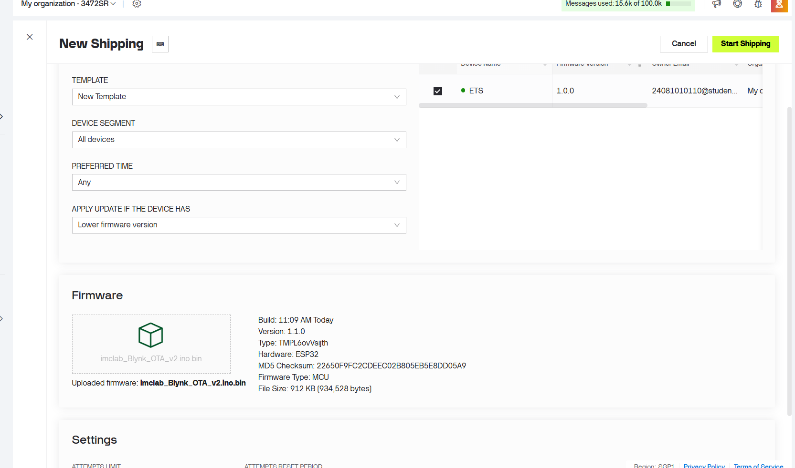
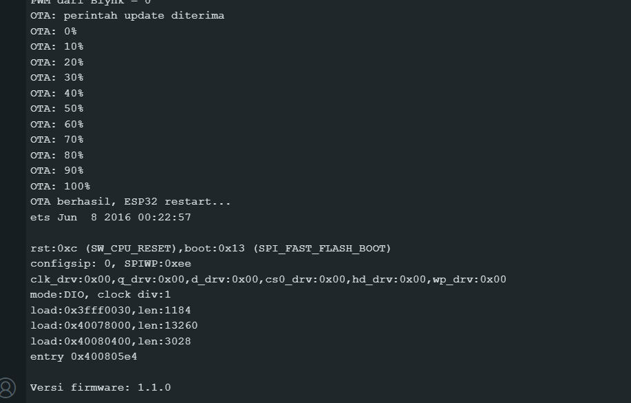
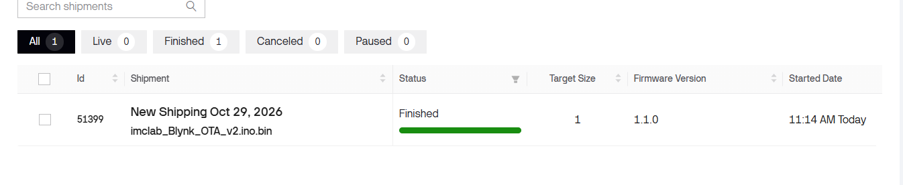
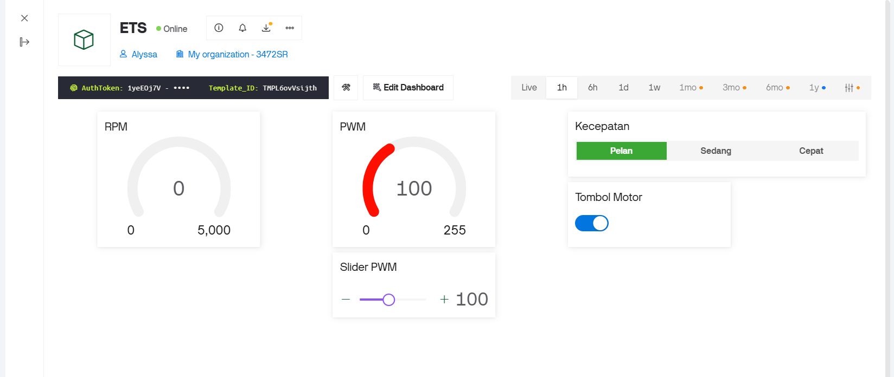
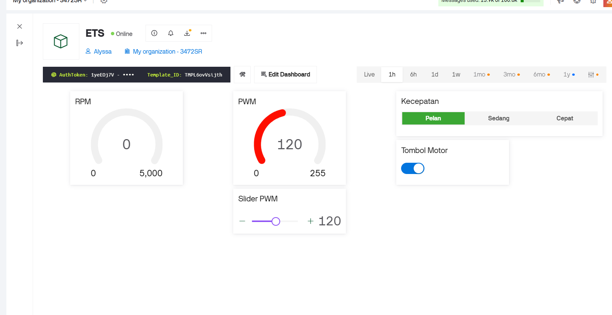

## Daftar Isi

- [Gambaran Umum](#gambaran-umum)
- [Perangkat yang Digunakan](#perangkat-yang-digunakan)
- [Eksperimen: OTA berbasis Blynk](#eksperimen-ota-berbasis-blynk)
- [Kesimpulan](#kesimpulan)

## Gambaran Umum
Pada Modul 1 sampai 3, setiap perubahan program harus diunggah lewat kabel USB. Modul 4 memindahkan langkah itu ke WiFi: firmware baru dikirim dari Blynk.Air (layanan OTA milik Blynk), diunduh sendiri oleh ESP32, lalu ESP32 restart dengan program baru. Kabel USB hanya diperlukan sekali, untuk mengunggah firmware pertama yang sudah memuat kode penerima OTA.

Alur yang terjadi pada sebuah update:
1. File `.bin` dari Arduino IDE diunggah ke Blynk.Console sebagai *shipment* (pengiriman firmware).
2. Blynk membandingkan versi firmware pada perangkat dengan versi pada file, lalu mengirim alamat (URL) file ke perangkat lewat pin internal OTA.
3. ESP32 mengunduh file itu, menulisnya ke flash, lalu restart.
4. Perangkat tersambung kembali ke Blynk dan melaporkan versi barunya. Itu tanda update berhasil.

Tujuan praktikum:
1. Menambahkan penerima OTA ke sketch Modul 3 menggunakan `BLYNK_FIRMWARE_VERSION` dan `BLYNK_WRITE(InternalPinOTA)`.
2. Membuat file firmware `.bin` dari Arduino IDE dan mengirimkannya lewat Blynk.Air.
3. Membuktikan bahwa firmware berubah tanpa kabel USB, lewat versi di Blynk dan perubahan perilaku kit.
4. Memahami pengaman yang diperlukan agar motor tidak berbahaya saat update dan setelah restart.

## Perangkat yang Digunakan

  
   <b>Gambar 1.</b> Kit iMCLab

| No | Bagian | Peran |
|---|---|---|
| 1 | ESP32 DevKit (modul ESP32-WROOM-32) | Pengendali, tersambung ke WiFi dan Blynk, menerima dan menulis firmware baru |
| 2 | IC driver motor 16 pin | Menyalurkan daya dari adaptor ke motor sesuai sinyal ESP32 |
| 3 | Motor DC dengan rumah putih cetak 3D | Aktuator yang diamati |
| 4 | Piringan putih pada poros | Penanda putaran yang melewati celah sensor |
| 5 | Modul sensor celah (*slot*) | Mendeteksi putaran piringan, keluarannya dibaca ESP32 di pin 13 |
| 6 | LED hijau dan resistor | Indikator pada papan |
| 7 | Tombol EN | Mereset ESP32 |
| 8 | Tombol BOOT | Ditahan saat unggah program bila proses macet di `Connecting...` |
| 9 | Konektor micro-USB | Dipakai untuk unggah pertama dan Serial Monitor. Update berikutnya tidak memerlukannya |
| 10 | Jack DC | Catu daya adaptor |

Pada ESP32 sendiri ada dua LED kecil: merah sebagai penanda daya, dan biru yang terhubung ke pin 2. LED biru menyala selama duty cycle lebih dari 0. Pada firmware 1.1.0, LED biru juga berkedip tiga kali setiap boot sebagai penanda bahwa firmware baru sudah berjalan.

| Perangkat lunak | Keterangan |
|---|---|
| Arduino IDE | versi 2.3.1 |
| Board | DOIT ESP32 DEVKIT V1 |
| Partition Scheme | skema yang memiliki dua slot aplikasi (OTA), misalnya Default 4MB with spiffs |
| Pustaka | `WiFi.h`, `BlynkSimpleEsp32_SSL.h`, `HTTPClient.h`, `Update.h` |
| Layanan | Blynk.Console, menu Developer Zone, Blynk.Air (OTA) |
| Sketch di ESP32 | `imclab_Blynk_OTA_v1.ino` (firmware 1.0.0) dan `imclab_Blynk_OTA_v2.ino` (firmware 1.1.0) |
| Port | COM6 |
| Serial Monitor | 115200 baud, *line ending* Newline |

Modul ini tidak memiliki kode dari dosen, jadi pembandingnya adalah sketch Modul 3 (`imclab_Blynk_v3.ino`).

### Sketch Modul 3 dan sketch OTA

| Aspek | Modul 3 (`imclab_Blynk_v3.ino`) | Modul 4 (`imclab_Blynk_OTA_v1.ino`) |
|---|---|---|
| Pustaka Blynk | `BlynkSimpleEsp32.h` | `BlynkSimpleEsp32_SSL.h`, ditambah `HTTPClient.h` dan `Update.h` |
| Versi firmware | tidak ada | `BLYNK_FIRMWARE_VERSION "1.0.0"` (baris 15) |
| Penerima OTA | tidak ada | `BLYNK_WRITE(InternalPinOTA)` (baris 260) |
| Motor saat OTA | tidak relevan | dimatikan oleh `motorStop()` sebelum unduhan dimulai |
| Nilai awal `dutyCycle` | 200 | 0 (baris 45) |
| Saat tersambung ke Blynk | `syncVirtual` V2, V3, V4: nilai tersimpan di server diterapkan ke motor | `kirimKeBlynk()`: dasbor mengikuti keadaan motor (baris 176) |
| Teks status V5 | dikirim, datastream belum dibuat | dihapus |

Pin, PWM 5000 Hz, dorongan awal 60 ms, tiga level kecepatan, perintah serial, dan datastream V0 sampai V4 sama dengan Modul 3.

### Firmware 1.0.0 dan 1.1.0

Dua firmware dibuat dari kode yang sama supaya hasil OTA dapat dibuktikan lewat perbedaan yang terlihat.

| Aspek | Firmware 1.0.0 | Firmware 1.1.0 |
|---|---|---|
| `BLYNK_FIRMWARE_VERSION` | `"1.0.0"` | `"1.1.0"` |
| Duty level Pelan | 100 (39,2%) | 120 (47,1%) |
| LED biru saat boot | tidak berkedip | berkedip 3 kali (`kedipBoot()`) |
| Banner Serial Monitor | `2 = Pelan  (duty 100)` | `2 = Pelan  (duty 120)` |

Duty level Sedang (150) dan Cepat (255) tidak berubah.

## Eksperimen: OTA berbasis Blynk

**Langkah:**
1. Isi token Blynk dan data WiFi pada kedua sketch. Pilih Partition Scheme yang mendukung OTA dan pastikan ukuran sketch muat di slot aplikasi.
2. Unggah `imclab_Blynk_OTA_v1.ino` lewat USB. Buka Serial Monitor dan tunggu `iMCLab + Blynk + OTA Ready (v1.0.0)`. Pastikan perangkat Online di Blynk.Console dan catat versi firmware pada informasi perangkat.
3. Dari dasbor, pilih level Pelan dan catat nilai PWM yang tampil.
4. Buka `imclab_Blynk_OTA_v2.ino`, lalu pilih Sketch, Export Compiled Binary. File `.bin` muncul di folder sketch.
5. Di Blynk.Console buka Developer Zone, Blynk.Air (OTA), lalu New Shipping. Pilih template, pilih perangkat, unggah file `.bin`, periksa informasi firmware, lalu Start Shipping.
6. Amati Serial Monitor selama update, lalu amati kit setelah restart. Catat versi firmware baru dan nilai PWM saat level Pelan dipilih lagi.
7. Uji pengaman: nyalakan motor, lalu mulai shipment dan amati apakah motor berhenti. Uji juga motor OFF lalu tekan tombol EN dan amati apakah motor menyala sendiri.

  
   <b>Gambar 2.</b> Pembuatan shipment di Blynk.Air

Keluaran Serial Monitor yang dirancang untuk sebuah update yang berhasil:

  
   <b>Gambar 3.</b> Serial Monitor saat proses OTA

### Hasil

Kolom "Hasil" diisi dari pengamatan saat praktikum.

| Tahap | Yang diamati | Yang diharapkan | Hasil |
|---|---|---|---|
| Unggah v1 lewat USB | Serial Monitor dan status perangkat | `Versi firmware: 1.0.0`, perangkat Online | Sesuai: banner `iMCLab + Blynk + OTA Ready (v1.0.0)` tercetak dan ETS Online |
| Level Pelan sebelum OTA | PWM pada dasbor | 100 | Sesuai: gauge dan slider PWM menunjukkan 100 (Gambar 5) |
| Shipment dimulai | Serial Monitor | `OTA: perintah update diterima`, lalu persentase naik sampai 100% | Sesuai: log naik 0% sampai 100% per 10%, lalu `OTA berhasil, ESP32 restart...` (Gambar 3) |
| Setelah restart | Serial Monitor, LED biru, versi di Blynk | `Versi firmware: 1.1.0`, LED berkedip 3 kali, versi 1.1.0 | `Versi firmware: 1.1.0` tercetak. Perangkat tidak tersambung ke Blynk karena `.bin` dibuat saat token dan WiFi masih placeholder. Setelah v2 berjalan dengan kredensial yang benar, LED biru berkedip 3 kali saat boot, sesuai rancangan `kedipBoot()`. Versi di informasi perangkat Blynk: 1.1.0 |
| Level Pelan sesudah OTA | PWM pada dasbor | 120 | Sesuai: gauge dan slider PWM menunjukkan 120 (Gambar 5). Diamati setelah v2 diunggah ulang lewat USB dengan kredensial yang benar |

  
   <b>Gambar 4.</b>

<table align="center">
  <tr>
    <td align="center"> Sebelum: firmware 1.0.0, Pelan = PWM 100</td>
    <td align="center"> Sesudah: firmware 1.1.0, Pelan = PWM 120</td>
  </tr>
</table>

<b>Gambar 5.</b>

### Analisis

- **Versi firmware menentukan apakah update dikirim.** Dokumentasi Blynk menyebut bahwa tanpa menaikkan versi, perangkat tidak mengenali firmware sebagai baru dan mengabaikannya.
- **Unggah pertama tetap lewat USB.** Perangkat hanya dapat menerima OTA bila firmware yang sedang berjalan sudah memuat penerima OTA. Firmware Modul 1 sampai 3 tidak memilikinya.
- **Pustaka versi SSL dipakai.** Sketch Modul 3 memakai `BlynkSimpleEsp32.h`, tetapi sketch OTA memakai `BlynkSimpleEsp32_SSL.h`.
- **Motor dimatikan sebelum unduhan.** Selama OTA, `loop()` tidak berjalan karena unduhan memblokir program, jadi motor yang sedang berputar tidak dapat dihentikan dari dasbor atau Serial Monitor. `motorStop()` mematikan PWM dan LED lebih dulu agar motor tidak berputar tanpa kendali selama beberapa detik.
- **Motor selalu mulai OFF setelah restart.** Pada Modul 3, `syncVirtual(V4)` berpotensi menyalakan motor kembali pada level Pelan setiap kali tersambung, karena nilai V4 tersimpan di server dan tidak berubah saat motor OFF. 
- **Update yang gagal tidak merusak firmware lama.**
- **Ukuran dan partisi membatasi OTA.** File `.bin` harus muat di satu slot aplikasi. Skema partisi tanpa slot OTA tidak dapat menerima update.
- **Jumlah shipment terbatas.** 
- **OTA hanya lewat WiFi.** Dokumentasi Blynk menyatakan OTA saat ini hanya bekerja lewat WiFi, jadi perangkat harus tersambung ke jaringan yang bisa mengakses internet.
- **Token dan WiFi ikut terkompilasi ke dalam file `.bin`.** Pada percobaan pertama, `.bin` firmware 1.1.0 dibuat dari sketch yang token dan WiFi-nya masih placeholder. OTA berhasil (log 0% sampai 100% dan `Versi firmware: 1.1.0`), tetapi setelah restart ESP32 mencari WiFi yang salah dan tidak dapat tersambung ke Blynk, sehingga firmware harus diunggah ulang lewat USB dengan kredensial yang benar. Sebelum Export Compiled Binary, pastikan token dan WiFi pada sketch sudah terisi.

## Kesimpulan

1. Firmware kit iMCLab dapat diperbarui lewat WiFi dengan Blynk.Air. Sketch memuat `BLYNK_FIRMWARE_VERSION` dan `BLYNK_WRITE(InternalPinOTA)`, sedangkan file `.bin` dikirim sebagai shipment dari Blynk.Console. Unggah pertama tetap memerlukan USB.
2. Pembuktian OTA memerlukan perbedaan yang terlihat antar versi. Firmware 1.1.0 mengubah level Pelan dari duty 100 ke 120 dan menambah kedipan LED saat boot, sehingga hasil update dapat dilihat dari versi di Blynk, Serial Monitor, nilai PWM, dan LED.
3. Pengaman menentukan apakah OTA layak dipakai pada perangkat dengan aktuator: motor dimatikan sebelum unduhan, motor mulai OFF setelah restart, dan kegagalan update tidak menghapus firmware lama.
